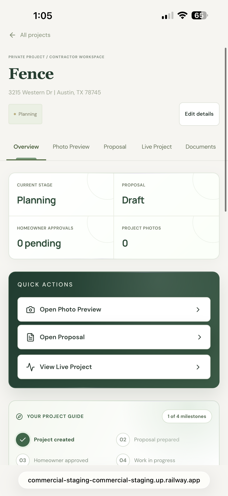
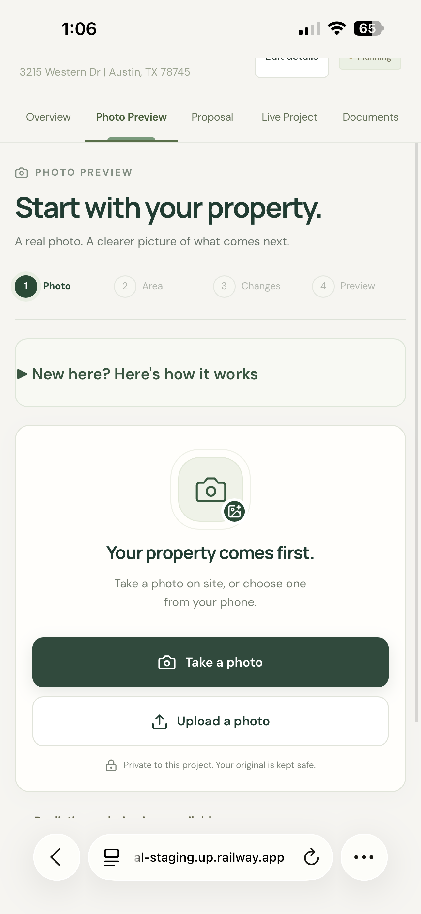
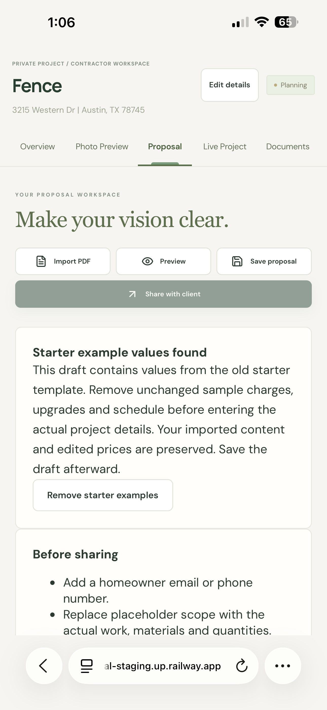
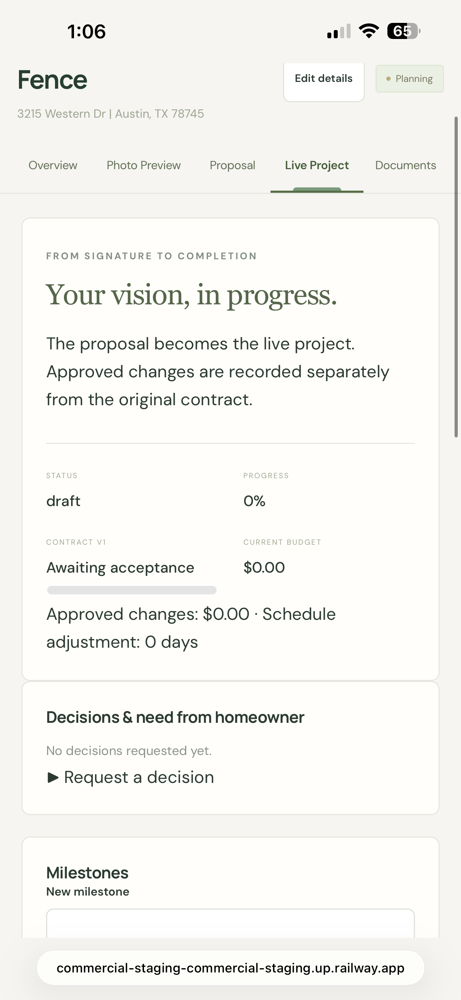

# PREMIUM+ Community Edition

**Professional tools for the people who do the work.**

[](https://github.com/zg9bkbrv7p-beep/premiumplus-community/actions/workflows/ci.yml)

PREMIUM+ Community Edition is an open-source initiative to give independent contractors and small remodeling businesses useful web tools for their own jobs, without a required PREMIUM+ software subscription.

## Calling independent contractors: help shape this project

**Are you a roofer, fence installer, painter, remodeler, landscaper, or another tradesperson?** We're looking for **10–20 contractors** to tell us what would make estimates, proposals, project photos, and homeowner decisions easier.

**[Share contractor feedback with a short form](https://github.com/zg9bkbrv7p-beep/premiumplus-community/issues/new?template=contractor-feedback.yml)** or [join the feedback conversation](https://github.com/zg9bkbrv7p-beep/premiumplus-community/issues/4).

You can inspect the free open-source code today. This is still a **pre-release**, not a customer-ready hosted service: use fictional project data for testing, and don't post real homeowner addresses or private records.

## See PREMIUM+ in action

Screenshots from the **existing PREMIUM+ Commercial staging app** on iPhone. These are screenshots of the separate Commercial staging app, **not identical to every Community Edition screen**. Tap an image to view the full screenshot.

| Project overview | Photo Preview |
|:---:|:---:|
| <a href="IMG_8360.png"></a> | <a href="IMG_8362.png"></a> |
| **Proposal editor** | **Live Project** |
| <a href="IMG_8363.png"></a> | <a href="IMG_8366.png"></a> |

Community Edition features may differ from these Commercial staging previews.

## Project status

**Public source available — Community Edition v0.1.0 RC2 (pre-release).**

The source is now included on the `main` branch under the [AGPLv3 license](LICENSE). Automated verification succeeded on [pull request #2](https://github.com/zg9bkbrv7p-beep/premiumplus-community/pull/2): clean Node.js 24 dependency install, TypeScript/Vite production build, unit/API tests, all **24 WebKit browser tests**, and a production dependency audit for high/critical findings.

**Still required before real customer use:** independent security and third-party licensing review, physical iPhone testing, hosting/privacy hardening, and backup/restore testing on a fresh deployment. This source release does **not** mean customer information is ready to be entrusted to a public host.

## Get the source

**[Download the Community Edition source ZIP](https://github.com/zg9bkbrv7p-beep/premiumplus-community/archive/refs/heads/main.zip)** — source code to inspect or install on your own computer. This is not a hosted customer-ready service.

## Work on the code with Codex

**[Set up Codex for this Community Edition](docs/CODEX_START.md)**. The repository also includes [Codex project instructions](AGENTS.md) covering tests, privacy, and safe changes. Codex should not assume this source is identical to the private Commercial staging app.

## Install your own copy

Follow the [Community Edition installation guide](docs/INSTALL.md) and [release checklist](docs/RELEASE_CHECKLIST.md).

```bash
npm ci
cp .env.example .env
npm run dev
```

Requires Node.js 24+ and Poppler utilities for PDF import. Use fictional test projects until the remaining checks are complete.

## Intended features

- Private project management and job tracking
- Estimates, scope of work, proposals, and PDF import
- Photos, local finish-color studies, and before/after comparison
- Documents, homeowner approvals, changes, and warranty follow-ups
- Optional design tools; AI remodeling renders are not included for free and are disabled by default

## Principles

- **Free to use, inspect, modify and share** under the AGPLv3 license.
- Your business and customer records belong to you; never commit customer data, passwords, secrets, photos, or databases into a public repository.
- No required PREMIUM+ software subscription; independent hosting, storage, email, or optional third-party services may incur costs.
- Community contributions are welcome after the first verified release.

## Help build the Community Edition

Want better tools for real contractor jobs? Start with the [contribution guide](CONTRIBUTING.md) or follow [the first public release milestone](https://github.com/zg9bkbrv7p-beep/premiumplus-community/issues/1). Please use fictional examples in public bug reports and screenshots.

## Release gate

Before hosting with real customer information: complete independent source and asset licensing review; validate cross-company permissions, production authentication, backups, PDF imports, image privacy, and on-device workflows. Automated tests do not replace operational security review.

**This repository is separate from the private PREMIUM+ Commercial service and repositories. No customer database or private configuration is included in this repository. Screenshots are public and may show example project details.**

For responsible vulnerability reports, see [SECURITY.md](SECURITY.md).

---
*Built for the people who build.*
